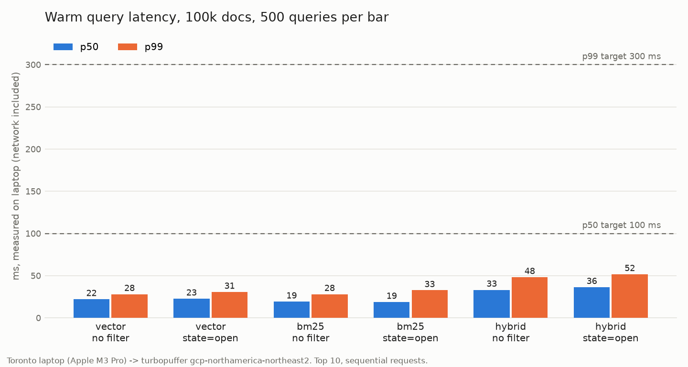
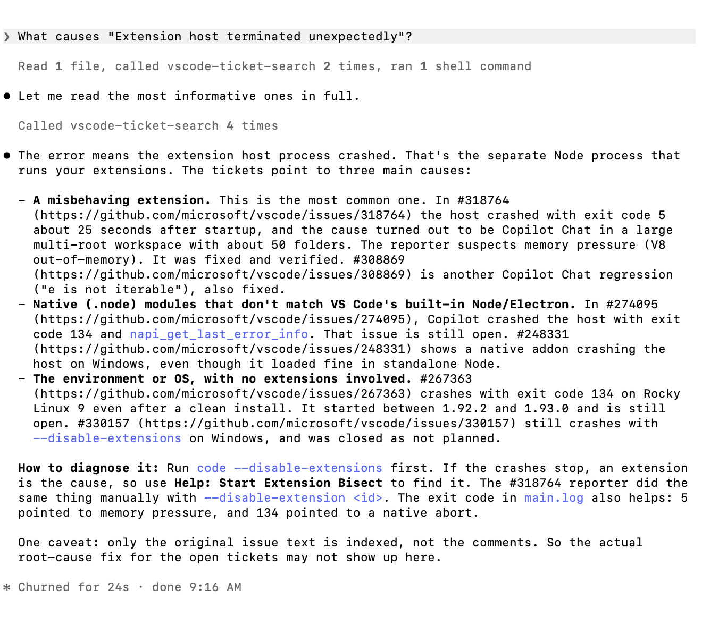
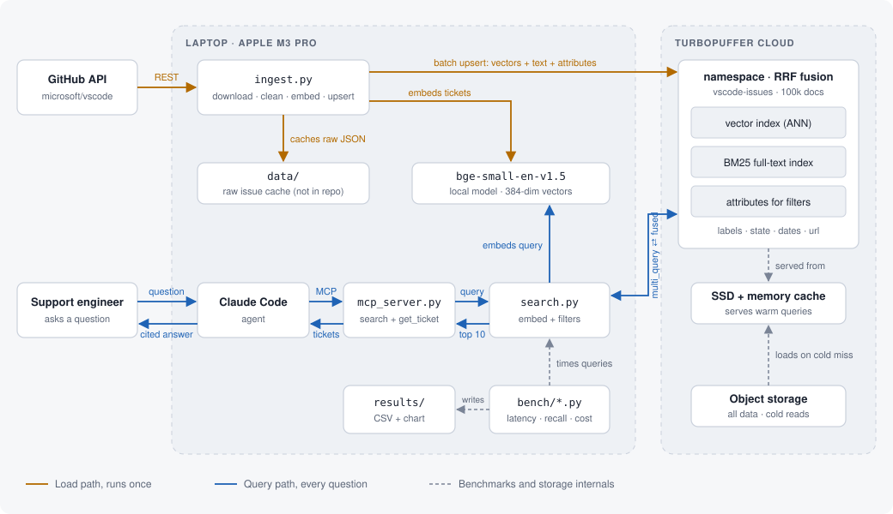

# Hybrid Search for an AI Support Agent: a turbopuffer POC

**The short answer: turbopuffer meets every requirement we could measure, and it was easy to build on.** Hybrid search over 100k support tickets returns in 33 ms at p50 and 48 ms at p99 from a laptop, vector recall@10 is 0.92 against exact search, and an AI agent answered 5 of 5 sample questions with 34 of 34 citations correct. Search is cheap too: under a cent per 1,000 queries, and about $9 a month for 1M tickets and 1M queries.

**By the numbers:** 100,000 tickets fetched from GitHub, embedded locally and loaded in 100 seconds; about 7,700 benchmark queries, with 0 errors across 6,000 timed runs.



## 1. The problem

A B2B developer-tools company has years of support tickets sitting in its issue tracker. The support team wants an AI agent that answers new questions by finding similar past tickets, so engineers stop re-solving problems that were already solved.

The customer has four requirements:

- **Cited answers.** Every answer links to the tickets it came from, so a support engineer can verify it in seconds.
- **Exact and fuzzy matching.** Questions mix plain language ("terminal hangs on launch") with exact strings like error messages and setting names, so search has to handle both.
- **Filters.** Agents need to narrow results by status, label and date, for example "open issues only."
- **Predictable cost.** The ticket archive keeps growing, so cost per million documents has to be known up front.

This POC tests whether turbopuffer meets those requirements. Public GitHub issues from `microsoft/vscode` stand in for the customer's ticket history: 100k real issues with titles, bodies, labels, open or closed state and dates.

## 2. Results

| Area | Target | Result | Status |
|---|---|---|---|
| Warm latency, hybrid | p50 < 100 ms, p99 < 300 ms | **33 ms / 48 ms** (36 / 52 ms with a filter) | Pass |
| Warm latency, vector and BM25 | same | 19 to 23 ms p50, 28 to 33 ms p99 | Pass |
| Cold latency | p99 < 1.5 s | Not observed (see caveats). First query after 13.5 h idle: **168 ms** | Not measured |
| Search quality | recall@10 ≥ 0.90 | **0.92** unfiltered, **0.99** with filters | Pass |
| Cost per 1M docs | reported | **< $0.01 per 1,000 queries**; ~$9 / month for 1M tickets and 1M queries | Reported |
| Agent answers | 5 of 5 with correct citations | **5 of 5**, 34 of 34 citations correct | Pass |

All numbers are from 100,000 documents, 500 queries per configuration, run on 2026-11-11 and 2026-11-12. Raw data and run details are in [`results/`](results/).

### Latency

Each of the 500 queries ran in six configurations: vector, BM25 and hybrid, each with and without a `state=open` filter. Requests were sent one at a time, top 10 results, timed on the laptop so network time is included.

| Mode | Filter | Client p50 | Client p99 | Server p50 |
|---|---|---|---|---|
| Vector | none | 22 ms | 28 ms | 10 ms |
| Vector | state=open | 23 ms | 31 ms | 10 ms |
| BM25 | none | 19 ms | 28 ms | 10 ms |
| BM25 | state=open | 19 ms | 33 ms | 10 ms |
| Hybrid | none | 33 ms | 48 ms | 10 ms |
| Hybrid | state=open | 36 ms | 52 ms | 10 ms |

**Server time is about 10 ms in every mode, so most of what the client sees is the network round trip.** Hybrid is about 11 ms slower on the client because it returns more data (about 220 KB vs 23 KB, since each sub-query sends back 50 candidates with full text), not because the server works harder. Filters add almost nothing. Embedding the question on the laptop adds about 74 ms on top, which a production deployment would move to a GPU or a hosted model.

### Search quality

recall@10 compares turbopuffer's approximate (ANN) top 10 with an exact brute-force top 10, computed locally over the same 100k vectors.

| Filter | Matching docs | Mean recall@10 | Queries with perfect recall |
|---|---|---|---|
| None | 100,000 | 0.921 | 57% |
| state=open | 15,564 (16%) | 0.994 | 94% |
| label=terminal | 588 (0.6%) | 0.993 | 93% |

**Filtered search does not lose recall**, even when the filter keeps only 0.6% of the corpus. That's the case where approximate indexes often struggle. The unfiltered misses are mostly near-ties: the median gap between the exact 10th result and the worst result turbopuffer returned is 0.002 in cosine similarity, so the agent still gets documents that are almost exactly as relevant.

### Cost

**Search spend is tiny.** Hybrid search costs about $0.0074 per 1,000 queries at 1M tickets, and storing a ticket costs about $0.0000012 a month. The namespace holds 0.37 GB, about 3.7 KB per ticket.

| Unit | At 100k tickets (measured) | At 1M tickets (projected) |
|---|---|---|
| Per 1,000 hybrid queries | $0.0026 | $0.0074 |
| Storage per month | $0.12 | $1.21 |
| One-time load | $0.37 | $3.68 |
| Monthly total with 1M queries and 10% of tickets updated | **$2.72** | **$8.94** |

**Growing the archive 10× raises the bill only about 3×**, because query pricing has volume tiers and a 1.28 GB per-query floor, so a small archive already pays the floor. The entire benchmark, about 7,700 queries and 12.5 TB billed, cost roughly one cent. Projections use turbopuffer's published list prices (checked 2026-11-11).

### Agent answers

Claude Code acted as the support agent, calling the search through an MCP server with two tools: `search_tickets` and `get_ticket`. It answered all five sample questions with linked citations, using 15 searches that took 15 to 61 ms each on the server. Full answers and grading notes are in [`results/2026-11-11-agent-answers.md`](results/2026-11-11-agent-answers.md).

| # | Question | Tests | Citations correct |
|---|---|---|---|
| 1 | Why does the integrated terminal freeze on startup? | Vector search | 6 / 6 |
| 2 | What causes "Extension host terminated unexpectedly"? | BM25 exact match | 7 / 7 |
| 3 | Are there open issues about high CPU from the file watcher on macOS? | State filter | 6 / 6 |
| 4 | How have people fixed Remote-SSH connection timeouts? | Closed, resolved tickets | 6 / 6 |
| 5 | What IntelliSense performance problems were reported in the last year? | Date filter | 9 / 9 |



*A fresh run of Q2 on 2026-11-12: two searches, four tickets read in full, then an answer with linked citations and a caveat about what the index can't see.*

The agent also said plainly when the tickets didn't answer the question. For Q3, it reported that no open macOS ticket matched exactly and pointed out that the only open file-watcher CPU bug is on Windows.

## 3. What turbopuffer got right

Beyond passing the targets, a few things stood out from building on turbopuffer for this POC. Each one is backed by data from this test.

- **Server time barely moves, whatever you ask.** Vector, BM25 and hybrid, filtered or not, all ran at 10 ms p50 on the server, with every p99 between 14 and 23 ms. The search mode is a product decision, not a performance trade-off.
- **Filters are close to free, and they don't cost recall.** Adding a filter moved client p50 by less than 4 ms. Recall stayed at 0.99 even when the filter kept only 0.6% of the corpus. That's a common weak spot for vector indexes that filter after the approximate search, and it didn't show up here.
- **Hybrid search is one call.** A single `multi_query` runs vector and BM25 side by side and fuses them on the server with reciprocal rank fusion. There's no second round trip and no fusion code to maintain.
- **Nothing to provision.** The namespace was created by the first write, with no cluster sizing or index tuning. 100k documents loaded in 100 seconds, and every one of the 6,000 timed queries was served fully from the index, with 0 documents left to scan unindexed.
- **The cost curve bends the right way.** Data lives in object storage with an SSD and memory cache in front, so storage is $1.21 a month per 1M tickets. Growing the archive 10× raised the projected bill only about 3.3×.
- **The cache holds.** After 13.5 hours with no traffic, the namespace was still fully cached, and the first query back took 103 ms on the server.
- **Every response shows its own latency and cost.** Each query returns server time, cache temperature and billable bytes. This POC's latency and cost tables were built from turbopuffer's own response data rather than estimates, which is exactly what a customer needs to trust a POC.
- **Small integration footprint.** The whole search layer and MCP server come to about 250 lines of Python, and there were 0 errors across about 7,700 queries.

### Field notes for the turbopuffer team

A few things a customer would ask about, from a deployed engineer's point of view:

- **Cold behavior is hard to test on demand.** There's no documented cache lifetime and no way to force a namespace cold, so cold latency could only be inferred. A documented eviction window, or a test switch, would make cold-start POCs easy.
- **One price is missing from the pricing page.** Data returned is billed per GB, but the rate isn't published, so cost models have one blind spot.
- **Two SDK details to call out in the docs.** Rows leave out attributes that are null, and datetimes come back as ISO strings. Both tripped up this POC during the build.
- **Explain the query minimum early in sizing.** Every sub-query is billed at least 1.28 GB, so small namespaces pay the floor and hybrid pays it twice. That's fine at scale, but worth saying up front.

## 4. Recommendation

**Adopt turbopuffer for this use case.** It meets every latency and quality target with wide headroom, hybrid search handles both plain-language questions and exact error strings, and search spend stays under $10 a month at 1M tickets and 1M queries.

**The first thing to fix is the data, not the search.** Only the original issue text is indexed, so when a fix lives in a maintainer's comment or a linked duplicate, the agent can find the right ticket but can't tell the user what solved it. That limited three of the five answers. Indexing the closing comment and the duplicate-target link for each ticket is the highest-value next step.

## 5. How it works



**Only the index and search run in the cloud.** Fetching, embedding, the MCP server and the benchmarks all run on a laptop, and turbopuffer's split between cache and object storage is why the results report warm and cold latency separately.

- **Data:** the 100,000 most recent `microsoft/vscode` issues (June 2023 to November 2026), pull requests excluded. 15,564 open, 84,436 closed.
- **Documents:** one per issue, no chunking. The vector comes from title plus the first 2,000 characters of the body. BM25 indexes title plus the first 8,000 characters. Filterable attributes: state, state reason, labels, created and closed dates.
- **Embeddings:** `BAAI/bge-small-en-v1.5` (384 dimensions, cosine), run locally on an Apple M3 Pro at about 150 docs per second in a 1k-doc test, so about 11 minutes for 100k, at no cost.
- **Load:** 100k documents upserted in 1,000-document batches in 100 seconds.
- **Hybrid search:** one `multi_query` call runs ANN and BM25 (50 candidates each) and fuses them server-side with reciprocal rank fusion.
- **Agent:** Claude Code, connected to a local MCP server. No LLM API key is needed.

## 6. Caveats

- **Cold latency was not observed.** turbopuffer has no way to force a namespace out of cache, and after 13.5 hours idle every query still reported a hot cache. The first query after that idle period took 168 ms on the client (103 ms on the server), well under the 1.5 s target, but that's not a true cold read. See `bench/cold.py` and `results/2026-11-11-cold-probes.csv`.
- **Single client, single region.** All timings are from one laptop in Toronto, on a home network, to `gcp-northamerica-northeast2`, with requests sent one at a time. Concurrency and throughput were not tested.
- **Queries are issue titles.** 495 of the 500 benchmark queries are randomly sampled issue titles (seed 42), plus the 5 sample questions. Titles are a fair stand-in for how people phrase questions, but they're not real support traffic.
- **Recall covers vector search only.** BM25 is exact by design, and hybrid has no single ground truth to compare against.
- **Cost is usage-based and projected.** It uses list prices, which the pricing page shows as upper bounds, assumes size grows linearly with document count, and excludes the charge for data returned, whose rate isn't published. turbopuffer plans also have a monthly minimum spend, which isn't included here.
- **Citation grading was manual.** 15 of the 34 citations were checked against the full ticket text and 19 against search snippets.

## 7. Run it yourself

Requirements: Python 3.11+, a turbopuffer account and a GitHub token with read access to public repos.

```bash
python -m venv .venv && .venv/bin/pip install -r requirements.txt
cp .env.example .env            # add GITHUB_TOKEN and TURBOPUFFER_API_KEY

.venv/bin/python src/ingest.py fetch     # download issues to data/ (cached)
.venv/bin/python src/ingest.py build     # clean into data/issues.jsonl
.venv/bin/python src/ingest.py embed     # local embeddings to data/vectors.npy
.venv/bin/python src/ingest.py upsert    # load into turbopuffer
.venv/bin/python src/ingest.py verify    # count and spot-check

.venv/bin/python src/search.py "terminal freezes on startup"
.venv/bin/python src/search.py "Extension host terminated unexpectedly" --mode bm25 --state open
```

**Agent:** start Claude Code from the repo root. `.mcp.json` registers the `vscode-ticket-search` server, so you can ask it any support question and it will search the tickets.

**Benchmarks:** run `bench/latency.py`, then `bench/recall.py`, `bench/cost.py` and `bench/chart.py`. Run `bench/cold.py` only after the namespace has been idle for a long time. Each script documents its method at the top.

## License

MIT
